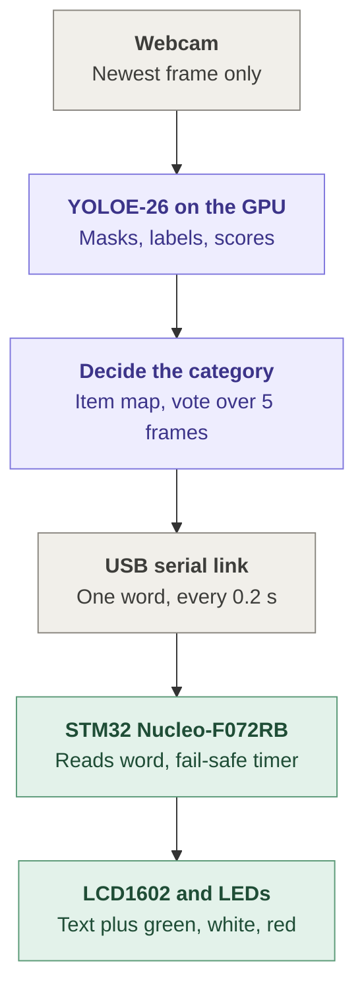

# BinGo ♻️

*An AI waste-sorting assistant, built at the TIDAL Hackathon.*

**An AI vision model and a microcontroller circuit that tell you which bin your trash goes in, at the moment you're about to throw it away.**

Hold an item up to the camera. **YOLOE-26** recognizes it automatically and sorts it into one of three categories. An **STM32 Nucleo-F072RB** then shows the answer on an **LCD1602** and lights the matching LED:

| Category | LCD shows | LED | Examples |
|---|---|---|---|
| Plastic & Aluminum | `Plastic&Aluminum` | 🟢 green | bottles, cans, jugs, foil, drink cartons, glass |
| Paper & Cardboard | `Paper&Cardboard` | ⚪ white | paper, newspaper, boxes, pizza boxes, egg cartons |
| Trash | `Trash` | 🔴 red | chip bags, wrappers, napkins, paper cups, styrofoam, food |

Built at the **TIDAL Hackathon, November 2026**.

---

## Why

U.S. recycling contamination typically runs **15–25%** ([SWANA](https://swana.org/docs/default-source/resources-documents/recycling-library/recycling-fact_or_myth-us.pdf)). One wrong item can lower the value of a whole load or send it to landfill. People usually sort wrong because they're unsure, not because they don't care.

Most fixes happen *after* collection, at sorting facilities. The National Academies' 2025 review notes that automated sorting **by households** may reduce contamination ([source](https://www.nationalacademies.org/read/27978/chapter/4)). This station works at exactly that point: it shows the right bin when the person is making the decision.

## How it works



🟪 Laptop (Python) &nbsp;&nbsp; 🟩 Board (C++)

The **laptop does all the thinking** and the **board does all the showing**. The only thing that crosses between them is one word.

### Design choices
- **Automatic detection, no training.** YOLOE is an *open-vocabulary* detector. We give it ~117 waste items written in plain English at startup. Supporting a new item takes one line of code, not a new dataset.
- **Distractor classes.** ~28 decoy classes (hand, face, t-shirt, phone…) are detected and then deliberately ignored. This stops a hand being forced into "napkin" just because nothing better was on the list.
- **Vote on the category, not the name.** If the label flickers between "bottle" and "water bottle", it doesn't matter: both are PLASTIC. The output is the majority vote over the last 5 frames.
- **Latest-frame camera thread.** Old frames are dropped instead of queued, so detection never lags behind reality.
- **Tiny protocol.** The board only receives short tags. Masks and probabilities stay on the laptop.
- **Heartbeat + fail-safe.** The laptop resends the current tag every 0.2 s. If the board hears nothing for 1.5 s, the LCD shows "Laptop offline" and all LEDs blink. The station never shows a stale answer as if it were current.

## Interdisciplinary by design

| Field | Where it shows up |
|---|---|
| Machine learning / computer vision | open-vocabulary segmentation, GPU inference, temporal smoothing |
| Software engineering | multithreaded Python, serial protocol design, Git |
| Embedded systems | STM32 firmware, UART, non-blocking real-time loop |
| Electrical engineering | LED current limiting, LCD interfacing, breadboard circuit |
| Environmental science | recycling categories and contamination |
| Human-centred design | colour-coded, instruction-free interface |

## Repo layout

```
vision/
  live_tags.py          MAIN PROGRAM: camera → YOLOE → PLASTIC/PAPER/TRASH → board
  sorter_yoloe.py       shared code (camera thread, serial link, distractors)
                        + an earlier 2-bin station with drop checking
  serial_link_test.py   tests laptop → board with no camera
  yoloe_test.py         quick YOLOE webcam test
  rfdetr_test.py        comparison test: RF-DETR
firmware/
  three_bins/three_bins.ino            MAIN BOARD CODE: LCD1602 + 3 LEDs
  simple_bins/simple_bins.ino          2-category version (LEDs + buzzer)
  recycle_station/recycle_station.ino  2-category version with LCD + RGB
  stm32cube/main_tags.c                2-category STM32CubeIDE (HAL) version
requirements.txt
```

`live_tags.py` imports from `sorter_yoloe.py`, so keep both files in `vision/`.

## Tech stack

```
┌─────────────────────────────────────────────────────────────┐
│  AI / VISION       YOLOE-26s-seg (Ultralytics, open-vocab)  │  ~120 waste classes + distractors
│                    PyTorch 2.11 + CUDA 12.8, RTX 4070 GPU   │
├─────────────────────────────────────────────────────────────┤
│  LAPTOP APP        Python 3.13, OpenCV (camera + overlay)   │  live_tags.py / sorter_yoloe.py
│                    NumPy (masks), pySerial (USB serial)     │  voting, heartbeat thread
├─────────────────────────────────────────────────────────────┤
│  LINK              USB → ST-Link VCP → UART 115200 8N1      │  "PLASTIC\n" "PAPER\n" "TRASH\n"
├─────────────────────────────────────────────────────────────┤
│  FIRMWARE          C++ (Arduino framework, STM32duino core) │  three_bins.ino
│                    LiquidCrystal library                    │  (alt: STM32CubeIDE / HAL in C)
├─────────────────────────────────────────────────────────────┤
│  HARDWARE          STM32 Nucleo-F072RB (Arm Cortex-M0)      │
│                    LCD1602 + 10 kΩ pot, 3 LEDs + resistors  │
└─────────────────────────────────────────────────────────────┘
```

## Setup (laptop: Windows, NVIDIA GPU)

```powershell
git clone https://github.com/rayyan429/BinGo.git
cd BinGo
py -3.13 -m venv venv
.\venv\Scripts\activate
python -m pip install --upgrade pip
pip install torch torchvision --index-url https://download.pytorch.org/whl/cu128
pip install -r requirements.txt
python -c "import torch; print(torch.__version__, torch.cuda.is_available())"   # want +cu128 True
```

The YOLOE weights and the MobileCLIP text encoder (~254 MB) download automatically on the first run. Both are git-ignored.

## Board setup (Arduino IDE)

1. **File → Preferences → Additional boards manager URLs:**
   `https://github.com/stm32duino/BoardManagerFiles/raw/main/package_stmicroelectronics_index.json`
2. **Boards Manager** → install **STM32 MCU based boards**.
3. **Tools → Board → Nucleo-64**, then **Board part number → Nucleo F072RB**, then **Upload method → Mass Storage**.
4. Open `firmware/three_bins/three_bins.ino` → **Upload**. On boot the board runs a self-test (green → white → red), then the LCD shows "Laptop offline" until the laptop connects.

## Wiring (Nucleo-F072RB, 3.3 V logic)

**LEDs:** pin → resistor → LED long leg; LED short leg → GND rail.

| Pin | Resistor | LED |
|---|---|---|
| D4 | 220 Ω | 🟢 Green: Plastic & Aluminum |
| D5 | 220 Ω | 🔴 Red: Trash |
| D6 | 100 Ω | ⚪ White: Paper & Cardboard |

**LCD1602 (16-pin parallel)**

| LCD pin | Connect to |
|---|---|
| 1 VSS | GND |
| 2 VDD | 5V |
| 3 V0 | middle leg of a 10 kΩ pot (outer legs to 5V and GND) |
| 4 RS | D12 |
| 5 RW | GND |
| 6 E | D11 |
| 11 / 12 / 13 / 14 (D4–D7) | D10 / D9 / D8 / D7 |
| 15 A | 5V through 220 Ω |
| 16 K | GND |

## Running

Close the Arduino Serial Monitor first (only one program can use the COM port at a time). Run these from the repo root:

```powershell
python vision\serial_link_test.py         # no camera: cycles IDLE → PLASTIC → PAPER → TRASH, then stops
python vision\live_tags.py                # the real thing (finds the Nucleo automatically)
python vision\live_tags.py --show-all     # also print every label YOLOE sees
python vision\live_tags.py --no-serial    # laptop only, no board
```

Useful flags for `live_tags.py`: `--conf 0.3` (min confidence), `--smooth 5` (vote window), `--camera 0`, `--port COM3`, `--baud 115200`. Press `q` in the video window to quit.

**To change what goes where**, edit `ITEMS` at the top of `vision/live_tags.py`. Bin rules vary by city (here, glass and drink cartons are in Plastic & Aluminum, and all cardboard counts as Paper).

## Serial tags

| Tag | LCD line 1 / line 2 | LED |
|---|---|---|
| `PLASTIC` | `Plastic&Aluminum` / `-> GREEN bin` | green |
| `PAPER` | `Paper&Cardboard` / `-> WHITE bin` | white |
| `TRASH` | `Trash` / `-> RED bin` | red |
| `IDLE` | `Show an item` / `to the camera` | off |
| (nothing for 1.5 s) | `Laptop offline` / `Run live_tags.py` | all blink |

## How the laptop talks to the Nucleo

The Nucleo's on-board **ST-Link** chip doubles as a USB-to-UART bridge (Windows shows it as "STLink Virtual COM Port"). The data path is:

1. pySerial writes a tag such as `PLASTIC\n` to that COM port.
2. The ST-Link forwards it over UART at 115200 baud to the STM32's USART2 (PA2/PA3, the D1/D0 header pins).
3. The sketch collects characters until the newline, then updates the LCD and LEDs.

One USB cable programs, powers and talks to the board, so no extra hardware is needed.

## Models we compared

| Model | Result |
|---|---|
| SAM 3 (Meta) + Depth Anything 3 | Accurate masks, but ~2 FPS on a laptop GPU: too slow for live use |
| YOLOv8x / YOLOv3 | Fast, but limited to the 80 COCO classes: no cans, paper or chip bags |
| RF-DETR (Roboflow) | Excellent masks, but the same 80 COCO classes without fine-tuning |
| **YOLOE-26 (chosen)** | Open vocabulary: detects our ~117 waste items in real time |

## Team

**BinGo** by team TidalByte, TIDAL Hackathon 2026.
